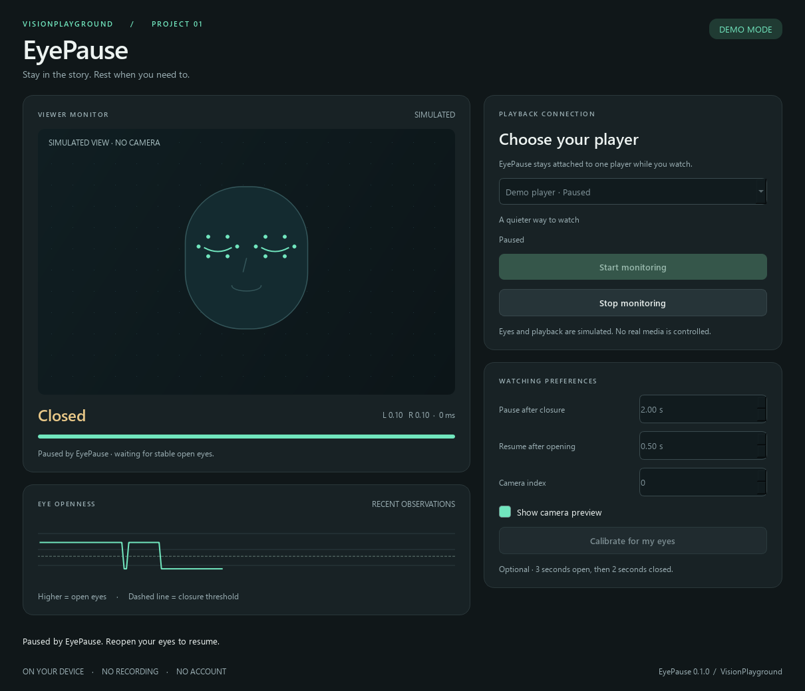

# EyePause

**Stay in the story. Rest when you need to.**

A Windows desktop application that watches for sustained eye closure, pauses your selected media player, and resumes when your eyes reopen. Built as project 01 in [VisionPlayground](../README.md).



[Animated walkthrough](docs/media/walkthrough.gif) · [Technical case study](docs/CASE_STUDY.md) · [Compatibility and verification](docs/VALIDATION.md) · [Evaluation guide](docs/EVALUATION.md)

## Try it

The portable app is built as `dist/EyePause-0.1.0-windows-x64.zip`. Extract the entire ZIP, then run `EyePause.exe`. Python is not required. The Windows workflow also produces a downloadable artifact on the repository's **Actions → EyePause Windows** page after it runs. Builds are not automatically published as releases.

For a camera-free walkthrough, run:

```powershell
.\EyePause.exe --demo
```

The demo explicitly simulates eye measurements and a media player. It never opens your camera or controls another application.

## Run from source

Requires **Windows 11 x64 and Python 3.13**. Run these commands inside this `Eyedetection` folder:

```powershell
py -3.13 -m venv .venv
.\.venv\Scripts\python.exe -m pip install -r requirements-lock.txt
.\.venv\Scripts\python.exe -m pip install --no-deps -e .
.\.venv\Scripts\python.exe scripts/download_model.py
.\.venv\Scripts\eyepause.exe --demo
```

Launch `eyepause.exe` without `--demo` for live monitoring. A convenience alternative for developers is `pip install -e ".[dev]"`; the lock file reproduces the verified build environment. Use the contrib OpenCV distribution included by MediaPipe; avoid installing both `opencv-python` and `opencv-contrib-python` into the same environment.

## Watch a video

1. Start playback in your browser or desktop media player.
2. Open EyePause and select its Windows media session. Available controls are checked before each playback action.
3. Choose the camera index (`0` usually means your default webcam). Optionally calibrate for your eyes.
4. Click **Start monitoring**. Normal blinks are ignored; two seconds of closed eyes pauses the player, and half a second of stable open eyes resumes it.
5. Click **Stop monitoring** to release the camera and clear automatic resume. Change preferences while stopped.

EyePause only resumes a session it successfully paused. It leaves already-paused media alone. When the viewer leaves the frame, multiple faces appear, or tracking becomes invalid, playback stays as it is. A disconnected player stops monitoring; the app does not switch to another player.

Closing the window hides it to the system tray. Use the tray's **Show**, **Stop monitoring**, or **Exit** actions. Exiting leaves playback in its current state.

## Media support

EyePause uses Windows media sessions rather than simulated keyboard input. Initial compatibility targets are YouTube and Netflix in Chrome/Edge, and Windows Media Player. A player must register a controllable session with Windows; browser sessions can combine tabs. See the [verification matrix](docs/VALIDATION.md) for actual test status. No browser extension is required.

If a player does not appear, begin playing a video and check that Windows' own media controls can see it. Unsupported players are not controlled through a fallback keypress. If the camera cannot open, check **Windows Settings → Privacy & security → Camera**, close other camera applications, or try another camera index.

## Privacy and settings

Camera frames stay in memory on your computer. There is no recording, account, server, or telemetry. Inference runs offline after setup; the portable build includes its verified model. The model download is an explicit development/setup step.

Preferences and calibration are stored at `%LOCALAPPDATA%\VisionPlayground\EyePause\settings.json`. No frames or media titles are saved. Demo mode does not modify your preferences.

## Development and evaluation

```powershell
.\.venv\Scripts\python.exe -m pytest -q
.\.venv\Scripts\python.exe -m ruff check src scripts tests packaging/entrypoint.py
.\.venv\Scripts\python.exe -m ruff format --check src scripts tests packaging/entrypoint.py
.\.venv\Scripts\eyepause-benchmark.exe trace examples/demo-trace.jsonl
.\.venv\Scripts\python.exe scripts/build.py
.\.venv\Scripts\python.exe scripts/verify_portable.py dist/EyePause-0.1.0-windows-x64.zip
```

The architecture separates landmark measurement, eye-state classification, playback policy, media integration, and presentation. See the [case study](docs/CASE_STUDY.md) for data flow and engineering tradeoffs, and the [evaluation guide](docs/EVALUATION.md) for annotated-video comparison against the historical brightness heuristic.

Original experiments are preserved under `experiments/legacy`. They are not used by the app; they can send global media keys if run directly. Their original cascade license remains intact.

Third-party model and runtime attribution: [THIRD_PARTY_NOTICES.md](THIRD_PARTY_NOTICES.md). Portable builds also include collected dependency license texts.

