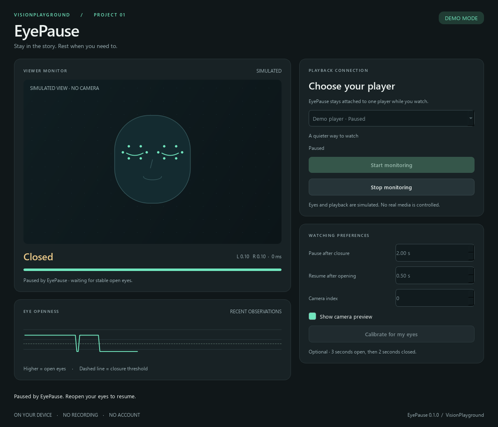
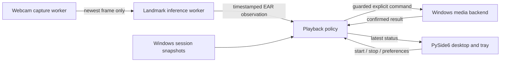

# EyePause: from an eye-detection script to a desktop application

EyePause connects a visual signal to an everyday interaction: pause a video while the viewer's eyes remain closed, then resume when they reopen. The project demonstrates how to turn computer vision output into predictable application behavior.



[Watch the simulated walkthrough](media/walkthrough.gif). The illustration, measurements, and player in that walkthrough are simulated; they demonstrate the application flow without implying real-camera accuracy.

## Starting point

The repository began with two OpenCV scripts. A Haar cascade located eye regions; mean or median brightness was used as a proxy for closure. A frame counter triggered repeated global keyboard commands. Neither script implemented ownership of a pause or reopening-based resume.

Brightness varies with illumination, skin, glasses, and camera exposure. A missing eye detection does not establish that an eye is closed. The optimized prototype also cached pixel regions by their coordinates, allowing old image data to influence later classifications. Its timing comparison included skipped frames, so it could not establish an equivalent-inference speedup.

The original files remain in the legacy archive, unmodified. EyePause replaces their production path rather than wrapping their side effects in a window.

## Visual measurement and temporal reasoning

The application uses Google's pretrained MediaPipe Face Landmarker. It does not train a new landmark model. For each eye, six eyelid landmarks produce an eye aspect ratio:

```text
EAR = (distance(p2,p6) + distance(p3,p5)) / (2 × distance(p1,p4))
```

Distances use pixel coordinates so the image's aspect ratio does not distort geometry. This follows the [landmark-based eye aspect ratio approach](https://dspace.cvut.cz/entities/publication/fbcbe690-daaf-4037-9edd-41a51703ecec). The application checks both eyes; a wink does not qualify as bilateral closure.

Separate closed/open thresholds provide hysteresis. Defaults are 0.20 and 0.24. Optional calibration collects three continuous seconds of open-eye samples and two of closed-eye samples. For each eye, the median closed/open EAR values define a gap; thresholds are placed at 35% and 65% of that gap. A gap below 0.05 is rejected and the previous settings are retained.

The playback policy uses monotonic timestamps, not frame counts. Default dwell times are two seconds closed and half a second open. Missing faces, multiple faces, invalid geometry, and observation gaps longer than 0.75 seconds reset pending timers. Tracking loss leaves playback unchanged.

## Architecture



Capture and inference communicate through a single-value mailbox. A slow inference step drops older frames rather than building a latency queue. The engine and Windows async operations run outside Qt's UI thread. Qt polls the latest immutable application status, so inference cannot flood its event queue.

The domain types, eye classifier, and playback policy do not depend on Qt, OpenCV, or Windows. Fake observations and media backends exercise their behavior deterministically. The demo uses the same policy as live mode with explicitly simulated measurements and playback.

## Making playback predictable

The selected session is an opaque runtime identity, not just an application name. EyePause uses [Windows media sessions](https://learn.microsoft.com/en-us/uwp/api/windows.media.control.globalsystemmediatransportcontrolssessionmanager) and explicit play/pause methods rather than focus-sensitive keys.

A confirmed pause establishes temporary ownership of that session and its observable media identity. Only that ownership permits reopening-based resume. Session disappearance, content changes, observable external transport changes, Stop, and Exit clear ownership. Failed or unconfirmed commands cannot establish it. One closure cycle produces at most one pause attempt.

Commands are serialized and recheck the target, content, revision, playback state, supported controls, and monitoring guard before dispatch. A late result after Stop cannot recreate ownership. An operation already dispatched to another application may finish after Stop; EyePause does not attempt to undo the user's playback state.

Windows exposes what the player publishes. A manual pause while media is already paused may produce no observable event. Browser sessions can aggregate tabs, and two items with identical published metadata may be indistinguishable. Stop is the explicit way to clear automatic resume in these cases. This release has no extension or global-key fallback.

## Evaluation and evidence

The [evaluation guide](EVALUATION.md) defines annotated trace and video evaluation. Metrics distinguish closure-event precision/recall, false pauses, inference time, processing throughput, and closure/reopening-to-command latency. The legacy comparison runs the brightness heuristic on the same video frames with the same temporal policy, isolating the detector difference.

The checked-in synthetic trace validates temporal/control behavior; its results are not evidence of real-camera detection accuracy. Hardware and streaming-service compatibility require separate checks. Actual results and untested scenarios are recorded in the [verification matrix](VALIDATION.md).

Next useful experiments are a consented, labeled clip set across lighting, eyewear, camera position, and participants; a calibrated-versus-default comparison; and measured media-command latency in supported players. Additional platform backends can reuse the observation and policy interfaces.

