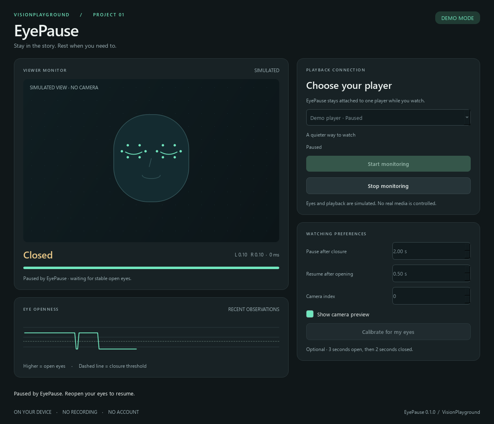

# VisionPlayground

A growing collection of computer vision projects by Samuel: from measurable visual signals to useful applications.

Each project includes its own setup, demonstration, technical explanation, and evaluation evidence. Models and upstream contributions are credited alongside the engineering built around them.

## Projects

| Project | What it demonstrates | Try it |
| --- | --- | --- |
| **01 · [EyePause](Eyedetection/README.md)** | Facial landmarks, bilateral eye aspect ratio, temporal filtering, state-aware Windows media control, and a local desktop application | [Walkthrough](Eyedetection/docs/media/walkthrough.gif) · [Case study](Eyedetection/docs/CASE_STUDY.md) · [Setup](Eyedetection/README.md#run-from-source) |
| **02 · [CoDriverSim](CoDriverSim/README.md)** | A MetaDrive driving world with an observer-only following-warning overlay using simulator truth; camera AI remains a future milestone | [Windows setup](CoDriverSim/README.md#windows-quick-start) · [Plan](CoDriverSim/docs/PLAN.md) · [Evaluation](CoDriverSim/docs/EVALUATION.md) |

## EyePause

EyePause pauses a selected media session after sustained eye closure and resumes after stable reopening. It runs locally on Windows, offers optional calibration, and includes a camera-free demo.

Portable builds are available as downloadable artifacts after the **EyePause Windows** workflow runs in [GitHub Actions](https://github.com/Sammieblz/VisionPlayground/actions). Local builds produce a ZIP under the project's `dist` directory. Builds are not automatically published as releases.

See the project's [verification matrix](Eyedetection/docs/VALIDATION.md) for the distinction between automated checks, model smoke tests, and manual service/player compatibility. Published performance figures identify their dataset and measurement method.

## Repository structure

Projects are self-contained folders with packaged source, tests, documentation, and reproducible tooling. EyePause retains the original `Eyedetection` folder path; the initial scripts are archived within that project for provenance.  

Future projects will be listed here as they are built. Shared infrastructure will be extracted when multiple projects need it.
